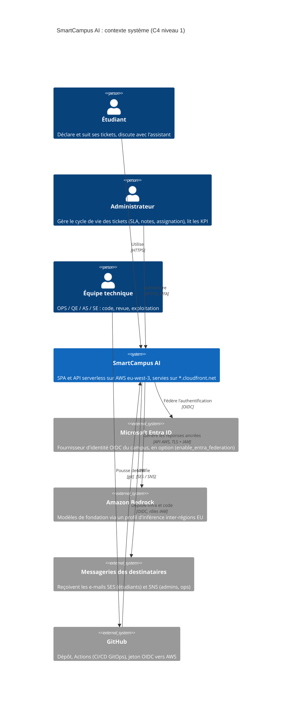

# 1 — Contexte système (C4 niveau 1)

Vue d'ensemble : qui utilise SmartCampus AI et de quels systèmes externes la plateforme dépend.

## Légende

- Personne : acteur humain. Système (bleu foncé) : SmartCampus AI, périmètre de l'équipe. Système externe (gris) : dépendance hors de notre contrôle.
- Chaque relation porte l'intention puis le protocole.
- Entra ID est optionnel : sans la bascule `enable_entra_federation`, les comptes sont locaux au User Pool Cognito.
- Pas de nom de domaine personnalisé : l'application est servie sur l'URL `*.cloudfront.net`.

## Description textuelle

Trois acteurs humains. Les étudiants et les administrateurs accèdent à SmartCampus AI en HTTPS depuis un navigateur ; les administrateurs ont une MFA obligatoire. L'équipe technique ne touche jamais AWS directement : elle pousse des pull requests sur GitHub, et GitHub Actions déploie l'infrastructure et le code dans AWS via OIDC, sans clé longue durée. SmartCampus AI dépend de trois systèmes externes : Microsoft Entra ID pour la fédération d'identité (optionnelle), Amazon Bedrock pour l'assistant (inférence maintenue dans l'UE), et les messageries des destinataires qui reçoivent les e-mails SES et les alertes SNS.

## Décisions liées

- [ADR-0003](../adr/0003-no-custom-domain.md) Pas de nom de domaine personnalisé
- [ADR-0005](../adr/0005-native-cognito-authorizer.md) Authorizer Cognito natif (couvre aussi les utilisateurs Entra fédérés)
- [ADR-0007](../adr/0007-s3-vectors.md) Knowledge Base Bedrock sur S3 Vectors
- [ADR-0009](../adr/0009-gitops-no-local-apply.md) GitOps, aucun apply local hors bootstrap
- [ADR-0012](../adr/0012-github-oidc-ci-identity.md) Identité CI par OIDC GitHub
