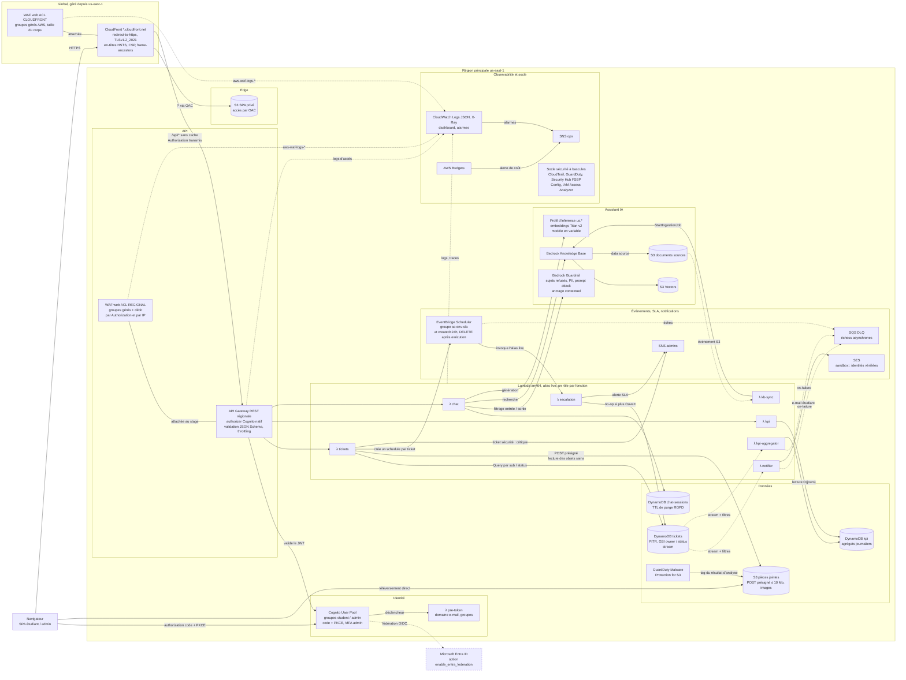

# 2 — Conteneurs et services AWS

Services AWS de l'architecture v3 et flux entre eux, pour un environnement (`sc-dev` ou `sc-prod`). Le chiffrement KMS et les identités sont détaillés dans le [diagramme 4](04-securite-identites.md).

## Légende

- Rectangle : service ou fonction. Cylindre : stockage (table DynamoDB, bucket, index vectoriel).
- Flèche pleine : appel synchrone. Flèche pointillée : événement asynchrone, échec routé ou flux de logs.
- Trait sans flèche : web ACL WAF attachée à la ressource qu'elle protège.
- Bordure pointillée : composant optionnel derrière une bascule `enable_*`.
- `λ` : fonction Lambda déployée par le module `lambda-service`.
- `sc-env` : préfixe de l'environnement (`sc-dev`, `sc-prod`).
- Région : `us-east-1`, imposée par le compte workshop ; WAF CLOUDFRONT et ACM sont donc dans la même région que le reste (ADR-0013). Pour une vraie production, `aws_region`, `backend.hcl` et le profil d'inférence (`eu.*`) ramènent la plateforme en `eu-west-3`, le provider `aws.us_east_1` gardant WAF CLOUDFRONT et ACM en `us-east-1`.

## Description textuelle

L'utilisateur atteint CloudFront en HTTPS, protégé par la web ACL CLOUDFRONT (us-east-1, comme tout le reste de la plateforme pendant l'atelier). CloudFront a deux comportements : `/*` sert la SPA depuis un bucket S3 privé via OAC, `/api/*` transmet sans cache, avec l'en-tête `Authorization`, à l'API Gateway REST régionale. Même origine, donc pas de CORS. L'URL `execute-api` restant joignable, l'API porte sa propre web ACL REGIONAL (règles de débit par utilisateur et par IP), la validation JSON Schema et le throttling.

L'authentification passe par Cognito (authorization code + PKCE, MFA pour les admins, fédération Entra ID en option). Le déclencheur `pre-token` contrôle le domaine e-mail et mappe les groupes. L'API valide le JWT avec l'authorizer Cognito natif, puis appelle `tickets`, `kpi` ou `chat`.

`tickets` lit et écrit la table `tickets` par requêtes indexées (jamais de `Scan`), génère les POST présignés vers le bucket des pièces jointes et ne lit que les objets marqués sains par GuardDuty Malware Protection. À chaque création, il programme une planification EventBridge Scheduler à 24 h qui invoque `escalation` ; celle-ci est sans effet si le ticket n'est plus « Ouvert », sinon elle alerte le topic SNS admins. Un ticket de catégorie sécurité alerte immédiatement les admins.

Le stream de la table `tickets` alimente, via des filtres d'événements, `notifier` (e-mails SES aux étudiants) et `kpi-aggregator` (agrégats journaliers dans la table `kpi`, lue par `kpi`). Les échecs asynchrones partent dans une DLQ SQS.

`chat` conserve les sessions dans `chat-sessions` (TTL RGPD), interroge la Knowledge Base Bedrock (index S3 Vectors, bucket de documents sources), génère via un profil d'inférence inter-régions US (`us.*`, profil EU en production réelle) et filtre par le Guardrail. Les embeddings de la Knowledge Base utilisent Titan Text Embeddings v2. Un dépôt de document déclenche `kb-sync`, qui lance l'ingestion.

Fonctions, API et web ACL écrivent dans CloudWatch Logs (et X-Ray) ; les alarmes et AWS Budgets publient sur le topic SNS ops. Le socle de sécurité de compte (CloudTrail, GuardDuty, Security Hub, Config, Access Analyzer) est activé par bascules.

## Correspondance avec les modules

| Composant | Module (`infra/modules/`) |
|---|---|
| CloudFront, bucket SPA, OAC, en-têtes | `static-site` |
| Web ACL CLOUDFRONT et REGIONAL | `waf` |
| Cognito, Entra, `pre-token` (configuration) | `identity` |
| API REST, stage, authorizer | `rest-api` |
| Fonctions Lambda | `lambda-service` (une instance par fonction) |
| Table `tickets` et stream | `tickets-store` |
| Table `chat-sessions` | `chat-sessions` |
| Table `kpi` | `kpi` |
| Pièces jointes, GuardDuty Malware Protection | `attachments-bucket` |
| Scheduler SLA, rôle d'exécution, DLQ | `sla-scheduler` |
| SNS admins / ops, identités SES | `notifications` |
| Guardrail | `bedrock-guardrail` |
| Knowledge Base, S3 Vectors, bucket des sources | `knowledge-base` |
| Logs, dashboard, alarmes | `observability` |
| Budget | `budget` |
| CloudTrail, GuardDuty, Security Hub, Config, Access Analyzer | `security-baseline` |

## Décisions liées

- [ADR-0003](../adr/0003-no-custom-domain.md) Pas de domaine : URL `*.cloudfront.net`, `execute-api` joignable
- [ADR-0004](../adr/0004-rest-api-regional-waf.md) API REST et deux web ACL
- [ADR-0005](../adr/0005-native-cognito-authorizer.md) Authorizer Cognito natif, BOLA traité par le `sub`
- [ADR-0006](../adr/0006-no-vpc.md) Lambda hors VPC
- [ADR-0007](../adr/0007-s3-vectors.md) S3 Vectors pour la Knowledge Base
- [ADR-0008](../adr/0008-per-ticket-sla-scheduler.md) Une planification Scheduler par ticket
- [ADR-0013](../adr/0013-workshop-region-us-east-1.md) Région us-east-1 imposée par le compte workshop
