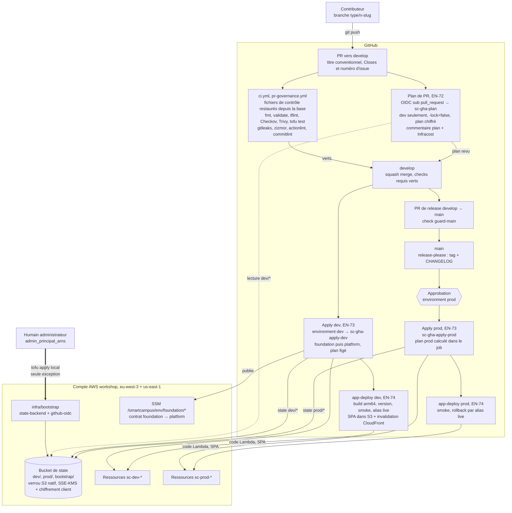

# 3 — Flux de déploiement GitOps

Chemin d'un changement, de la branche de travail jusqu'à prod. Seule la CI applique ; le bootstrap est l'unique apply local, exécuté par un humain.

## Légende

- Rectangle : workflow, job ou étape. Hexagone : approbation manuelle. Cylindre : stockage.
- Flèche épaisse : apply manuel local (bootstrap uniquement). Flèche pleine : enchaînement CI ou écriture. Flèche pointillée : lecture seule.
- `sc-gha-*` : rôles IAM assumés par OIDC, sans clé longue durée (détail au [diagramme 4](04-securite-identites.md)).
- `env` : `dev` ou `prod`.

## Description textuelle

Le bootstrap (`infra/bootstrap` : bucket et clé KMS du state, fournisseur OIDC, rôles CI et boundaries) est la seule exception au GitOps : un humain listé dans `admin_principal_arns` l'applique localement, puis migre son state dans le bucket.

Tout autre changement part d'une branche `type/n-slug` et d'une PR vers `develop`. `ci.yml` et `pr-governance.yml` restaurent d'abord les fichiers de contrôle depuis le commit de base, pour qu'une PR ne puisse pas affaiblir les checks qui la contrôlent, puis lancent formatage, lint, scanners de sécurité et tests. Le job de plan assume `sc-gha-plan` (confiance `pull_request`, lecture seule), lit uniquement le state de dev sans poser de verrou, conserve un plan chiffré et commente le plan et la différence de coût Infracost.

Après le squash merge sur `develop`, le job d'environnement `dev` assume `sc-gha-apply-dev` et applique `foundation` puis `platform`. `foundation` publie ses sorties dans SSM pour `platform`. `app-deploy` construit ensuite les artefacts arm64, publie une version, bascule l'alias `live` après les smoke tests, publie la SPA et invalide CloudFront. OpenTofu ignore le code des fonctions, ce qui évite toute dérive.

La release passe par une PR `develop` → `main` (check `guard-main`). Sur `main`, le job d'environnement `prod` attend l'approbation d'un réviseur, calcule le plan de prod dans le job, l'applique avec `sc-gha-apply-prod`, puis `app-deploy` déploie le code en prod, avec rollback par l'alias `live`.

## Points ouverts

- Rôle de déploiement applicatif (EN-74) : distinct du rôle apply infra, créé dans le bootstrap ou la foundation, à trancher. Il n'est pas représenté comme rôle séparé.
- EN-72 AC1 prévoit un plan de prod sur la PR de release ; ADR-0012 (F5) l'interdit (state de prod invisible des workflows `pull_request`). Le diagramme suit l'ADR : plan de prod dans le job d'apply, derrière l'approbation. EN-72 AC1 est à aligner.
- Les noms de fichiers des workflows plan, apply et app-deploy ne sont pas encore fixés ; seuls `ci.yml` et `pr-governance.yml` sont nommés (ADR-0010).

## Décisions liées

- [ADR-0001](../adr/0001-opentofu.md) OpenTofu
- [ADR-0002](../adr/0002-single-account-dev-prod.md) Dev et prod dans un compte unique
- [ADR-0009](../adr/0009-gitops-no-local-apply.md) GitOps, aucun apply local hors bootstrap
- [ADR-0010](../adr/0010-base-pinned-gate-files.md) Fichiers de contrôle épinglés sur le commit de base
- [ADR-0011](../adr/0011-state-backend-bootstrap.md) Backend de state et bootstrap
- [ADR-0012](../adr/0012-github-oidc-ci-identity.md) Rôles OIDC plan / apply
