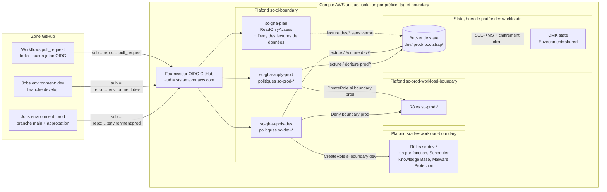
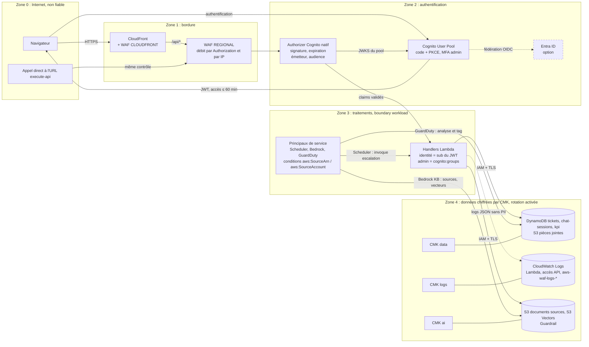

# 4 — Frontières de sécurité et identités

Deux vues : (a) identité de la CI, permissions boundaries et isolation dev / prod dans le compte unique ; (b) frontières de confiance à l'exécution, identité des utilisateurs et chiffrement KMS par domaine.

## 4a — Identité CI et permissions boundaries

### Légende

- Sous-graphe « Plafond » : permissions boundary. Elle n'accorde rien, elle borne les rôles qu'elle contient.
- Flèche pleine : droit d'écriture ou de création. Flèche pointillée : lecture seule. Flèche terminée par une croix : action explicitement refusée.
- `repo:…` : `repo:smart-campus-ai/smart-campus-ai`, condition `StringEquals` sans joker.

### Description textuelle

GitHub Actions présente un jeton OIDC au fournisseur du compte (audience `sts.amazonaws.com`). Le `sub` du jeton détermine le rôle : `pull_request` donne `sc-gha-plan`, l'environnement `dev` donne `sc-gha-apply-dev`, l'environnement `prod` (limité à `main`, avec approbation) donne `sc-gha-apply-prod`. Les PR de forks n'obtiennent pas de jeton. Aucune clé longue durée n'existe.

Les trois rôles sont plafonnés par `sc-ci-boundary`. Celle-ci leur interdit de modifier les boundaries, leur propre identité `sc-gha-*` et le fournisseur OIDC, et de créer des utilisateurs ou des clés d'accès. Le rôle plan lit tout sauf les données (secrets, items, logs, messages) et seulement le state de dev, sans verrou. Chaque rôle apply n'écrit que sous le préfixe de state de son environnement et ne crée que des rôles `sc-<env>-*` portant la boundary workload de cet environnement ; la boundary de l'autre environnement est refusée.

Les boundaries workload limitent tout rôle applicatif aux ressources `sc-<env>-*` ou au tag `Environment=<env>`. Elles excluent IAM, le bucket et la clé de state, et toute session fédérée. Le bucket de state est chiffré deux fois, côté serveur par la CMK de state et côté client par OpenTofu. Une partie des risques résiduels n'est pas représentée : ressources non taggables, contenu des politiques de confiance. Ils sont listés dans l'ADR-0012.

## 4b — Frontières de confiance, identité utilisateur et KMS par domaine

### Légende

- Zone : frontière de confiance. Une requête ne passe à la zone suivante qu'après le contrôle de la zone qu'elle quitte.
- Trait sans flèche entre une CMK et un stockage : clé qui chiffre ce stockage.
- Bordure pointillée : composant optionnel (`enable_entra_federation`).
- Toutes les CMK existent par environnement (alias `sc-<env>-data`, `-logs`, `-ai`). La CMK de state, partagée, est sur la vue 4a.

### Description textuelle

Zone 0 : tout ce qui vient d'Internet est non fiable, y compris un appel direct à l'URL `execute-api`, qui ne peut pas être désactivée sans domaine personnalisé. Zone 1 : CloudFront applique la web ACL CLOUDFRONT, TLS 1.2 minimum et les en-têtes de sécurité. Chaque appel à l'API, qu'il vienne de CloudFront ou d'un appel direct, passe ensuite par la web ACL REGIONAL et ses limites de débit.

Zone 2 : l'utilisateur s'authentifie auprès de Cognito (code + PKCE, MFA pour les admins, fédération Entra en option) et reçoit un jeton d'accès de 60 minutes au plus. L'authorizer natif de l'API vérifie la signature, l'expiration, l'émetteur et l'audience ; un jeton absent ou invalide donne 401.

Zone 3 : les handlers prennent l'identité de l'étudiant dans le `sub` du JWT, jamais dans la requête (OWASP API1/BOLA), et vérifient `cognito:groups` pour les méthodes admin. Chaque fonction a son rôle, plafonné par la boundary workload de l'environnement. Les services AWS qui assument un rôle (Scheduler, Bedrock, GuardDuty Malware Protection) sont limités par `aws:SourceArn` et `aws:SourceAccount` (protection contre le confused deputy).

Zone 4 : les données sont chiffrées par trois CMK de domaine. `data` couvre les tables et le bucket des pièces jointes, `logs` les groupes CloudWatch Logs, dont les logs WAF, `ai` le bucket des sources, l'index S3 Vectors et le Guardrail. Les logs ne contiennent ni en-tête `Authorization`, ni corps de requête, ni PII en clair. Tous les accès aux services AWS passent par TLS et IAM, sans VPC.

## Décisions liées

- [ADR-0002](../adr/0002-single-account-dev-prod.md) Compte unique, isolation par préfixe
- [ADR-0004](../adr/0004-rest-api-regional-waf.md) Deux web ACL, protection de `execute-api`
- [ADR-0005](../adr/0005-native-cognito-authorizer.md) Authorizer Cognito natif, BOLA par le `sub`
- [ADR-0006](../adr/0006-no-vpc.md) Pas de VPC : TLS + IAM vers les API régionales
- [ADR-0007](../adr/0007-s3-vectors.md) S3 Vectors chiffré par la CMK `ai`
- [ADR-0011](../adr/0011-state-backend-bootstrap.md) CMK de state dédiée, double chiffrement
- [ADR-0012](../adr/0012-github-oidc-ci-identity.md) Rôles OIDC, boundary CI et boundaries workload par environnement
- [ADR-0013](../adr/0013-workshop-region-us-east-1.md) Région us-east-1, données hors UE acceptées pour l'atelier (utilisateurs de test)
